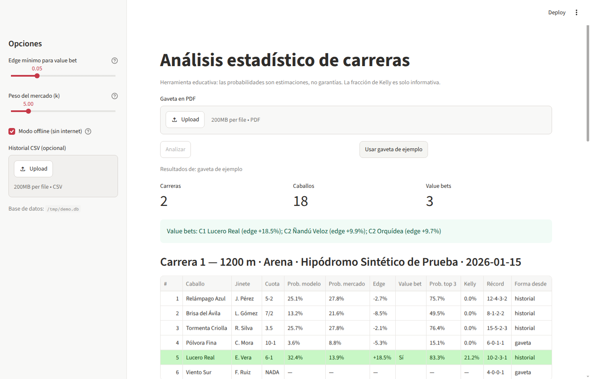

# Sistema Hípico — análisis estadístico de carreras de caballos

Pulsa **Buscar gaceta de hoy** (o sube una **gaveta** en PDF) y obtén, por cada carrera, la
probabilidad de victoria de cada caballo según el mercado y según un modelo de Harville
ajustado por historial, el **edge** entre ambos y los posibles **value bets** resaltados en
verde. Todo corre en tu PC y es gratis; solo la búsqueda de la gaceta usa internet. La especificación completa está en
[`PROJECT_SPEC.md`](PROJECT_SPEC.md).



> Herramienta educativa: las probabilidades son estimaciones, no garantías.

## Instalación (≈5 minutos)

Requisitos: **Python 3.11 o superior** ([python.org](https://www.python.org/downloads/);
en Windows marca «Add python.exe to PATH» al instalar) y **Git**.

### Windows (PowerShell o CMD)

```bat
git clone https://github.com/Edmartinezzz/Sistema-Hipico.git
cd Sistema-Hipico
py -3.11 -m venv .venv
.venv\Scripts\activate
pip install -r requirements.txt
```

Si PowerShell no deja ejecutar `activate`, usa CMD o ejecuta una vez:
`Set-ExecutionPolicy -Scope CurrentUser RemoteSigned`.

### Linux / macOS

```bash
git clone https://github.com/Edmartinezzz/Sistema-Hipico.git
cd Sistema-Hipico
python3.11 -m venv .venv
source .venv/bin/activate
pip install -r requirements.txt
```

### Traer cambios nuevos

```bash
git pull
pip install -r requirements.txt   # solo si cambió requirements.txt
```

## Uso

Con el entorno activado, desde la carpeta del proyecto:

```bash
streamlit run src/app.py
```

Se abre el navegador en <http://localhost:8501>.

1. Elige el hipódromo (La Rinconada o Valencia) y pulsa **Buscar gaceta de hoy**: la app
   descarga la reunión de [Desafío Hípico](https://www.desafiohipico.com/retrospectos) y,
   si falla, la revista PDF de pollamacaco.com (solo La Rinconada). También puedes pulsar
   **Usar gaveta de ejemplo** o subir tu gaveta en PDF y pulsar **Analizar**.
2. Revisa la tabla de cada carrera: Caballo, Jinete, Cuota, Prob. modelo, Prob. mercado,
   Edge, Value bet, Prob. top 3, Kelly, Récord y de dónde salió la forma (gaveta o
   historial). Las filas verdes son value bets.
3. En **Detalle por caballo** verás los datos del historial y las carreras guardadas en
   la base de datos local.

En la barra lateral puedes:

- **Edge mínimo para value bet** (por defecto 5 %): diferencia mínima modelo − mercado.
- **Peso del mercado (k)**: cuántas carreras "vale" la opinión del mercado frente al
  récord del caballo. Con `k` alto el modelo se parece más al mercado.
- **Modo offline**: activado por defecto; no usa internet.
- **Historial CSV**: un CSV con `name`, `starts`, `wins`, … para mejorar el modelo
  (formato en [`docs/fuentes_datos.md`](docs/fuentes_datos.md)). Si usas la gaveta de
  ejemplo sin subir CSV, se usa `data/samples/historial_ejemplo.csv` (ficticio).

## Cómo se calcula

1. **Prob. mercado**: `1 / cuota decimal`, normalizada para que la carrera sume 100 %
   (se elimina el margen de la casa). Las cuotas `7-2`, `5/1`, `9:2`, `EVEN` y decimales
   se convierten automáticamente; `NADA`/`SCR` = retirado.
2. **Fuerza de cada caballo**: promedio bayesiano entre el mercado `m` y su tasa de
   victorias: `s = (victorias + k·m) / (carreras + k)`. Sin historial, `s = m`.
3. **Prob. modelo** (Harville): `s_i / Σ s`. Prob. top 3 con Harville recursivo.
4. **Edge** = Prob. modelo − Prob. mercado. Si supera el umbral → value bet.
5. **Kelly** = `(b·p − q) / b` con `b = cuota − 1`: fracción teórica del bankroll
   (solo informativa).

## Limitaciones

- El PDF debe tener **texto y tablas con bordes**. Los PDFs escaneados (imágenes) no se
  leen (no hay OCR) y la app avisa. Gavetas con otro diseño pueden necesitar ajustes en
  `src/pdf_extractor.py`; si alguna no se lee bien, guarda el PDF (sin subirlo al repo) y
  se puede adaptar.
- El récord de la gaveta se interpreta como `carreras-1.º-2.º-3.º`.
- Las gacetas de internet **no traen cuotas**: la app calcula la Prob. modelo con el
  historial del caballo y un mercado uniforme, pero sin cuotas no hay Prob. mercado, edge,
  value bets ni Kelly.
- Las fuentes en línea pueden cambiar su diseño sin aviso; si la búsqueda falla, la app
  lo dice y puedes subir el PDF a mano.
- No hay scrapers de DRF ni Brisnet (ver [`docs/fuentes_datos.md`](docs/fuentes_datos.md)).

## Variables de entorno (opcionales)

| Variable | Uso | Por defecto |
| --- | --- | --- |
| `HORSE_DB_PATH` | Archivo SQLite | `data/horse_analytics.db` |
| `HORSE_CSV_PATH` | CSV de historial por defecto | — |
| `HORSE_DATA_URL` | Fuente HTTP JSON con `{name}` (solo sin modo offline) | — |

## Desarrollo

```bash
pytest                         # todas las pruebas (sin red)
python -m compileall -q src/
python -m src.sample_data data/samples/gaveta_ejemplo.pdf   # regenerar la gaveta sintética
```

Uso de los módulos desde Python:

```python
from src.pdf_extractor import extract_races
from src.pipeline import analyze_pdf

caballos = extract_races("data/samples/gaveta_ejemplo.pdf")
resultado = analyze_pdf("data/samples/gaveta_ejemplo.pdf",
                        csv_path="data/samples/historial_ejemplo.csv")
for carrera in resultado["races"]:
    for fila in carrera["rows"]:
        if fila["value_bet"]:
            print(carrera["race_number"], fila["horse_name"], f"{fila['edge']:+.1%}")
```

## Estructura

```
src/
  pdf_extractor.py   PDF → lista de caballos por carrera (incluye formato Movil Hipismo)
  gaceta_online.py   busca la gaceta del día (Desafío Hípico → pollamacaco.com)
  scraper.py         enriquecimiento: CSV → SQLite → HTTP (rate limit, offline)
  harville_model.py  probabilidades, Harville, value bets, Kelly
  pipeline.py        une extractor + enriquecimiento + modelo
  database.py        capa SQLite
  sample_data.py     genera gavetas PDF sintéticas (reportlab)
  app.py             dashboard Streamlit
tests/               pruebas con pytest
data/samples/        gaveta y historial de ejemplo (sintéticos)
docs/                fuentes de datos y captura
```
